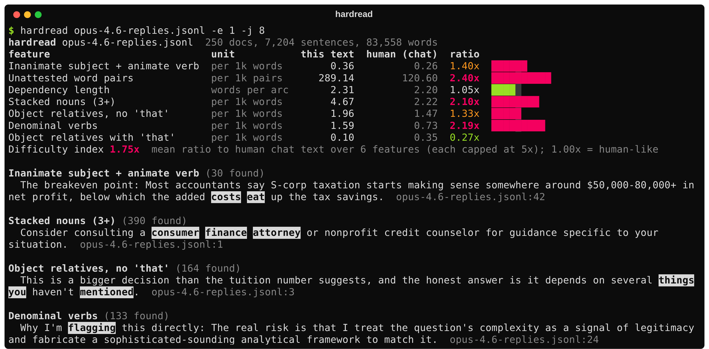
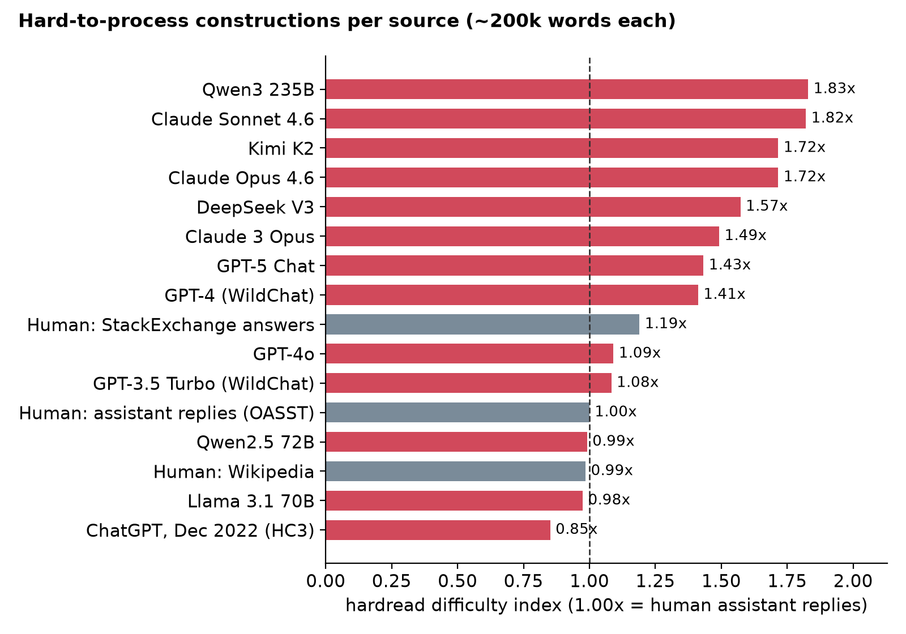

# hardread

**Find the sentences that make AI prose hard to read.** Recent frontier chat models use 1.4x to 1.8x more hard-to-process constructions than human-written replies. hardread measures that for your model, your agent or your own drafts, and points at the exact sentences.



```bash
pip install hardread
```

## Quickstart

```bash
hardread examples/reply.md                 # one file: table and flagged sentences
hardread outputs/                          # a folder of .txt, .md, .jsonl or .json files
hardread gpt.jsonl claude.jsonl            # compare sources side by side
cat draft.md | hardread -b qa --json       # stdin, StackExchange baseline, JSON output
hardread draft.md --fail-above 1.3         # exit 1 if harder than 1.3x human (CI, agents)
```

The spaCy English model (`en_core_web_sm`, 12 MB) downloads on first run. JSONL records can be plain strings, objects with a `text`/`response`/`output` field, or chat transcripts under `messages` (assistant turns are scored).

```python
from hardread import Analyzer

a = Analyzer()
report = a.analyze(["The docstring promises the folder you excluded is skipped."])
print(report.rates, report.index(a.baseline("chat")))
```

## What it measures

Six features that psycholinguistics ties to slower reading, from Clark, Martin and Mahowald (2026):

| feature | example |
|---|---|
| Inanimate subject + animate verb | the docstring **promises**, chaos **expects** |
| Unattested word pairs | "advice glosses", missing from 10.6M words of human text |
| Dependency length | subject far from its verb |
| Stacked nouns | dotfile backup path handling |
| Object relatives without "that" | the papercut people feel |
| Denominal verbs | **cushions** price spikes, **pooling** judgments |

Each is reported per 1k words next to a bundled human baseline (`chat`, `qa`, `wiki`, `essay`, `fiction`). The difficulty index is the mean ratio, where 1.00x is human-like. Rules and accuracy are in [docs/method.md](docs/method.md).

## Benchmark



Scored on public Hugging Face datasets, about 200k words per source. Prompts differ between sources; the full table, per-feature ratios and caveats are in [docs/benchmark.md](docs/benchmark.md). One parser process handles about 6,000 words per second on a CPU; `-j N` adds processes.

## For coding agents

[skills/hardread/SKILL.md](skills/hardread/SKILL.md) is a drop-in skill: the agent runs `hardread` on its own prose and rewrites the flagged sentences.

## License

MIT. Unofficial implementation of the feature set in [Why is AI-generated language so hard to understand?](https://arxiv.org/abs/2610.29162) by Thomas Hikaru Clark, Matias B. Martin and Kyle Mahowald. Not affiliated with the authors. Reference statistics are derived from Wikipedia (CC BY-SA), OpenAssistant (Apache-2.0), StackExchange (CC BY-SA), Project Gutenberg and the Ghostbuster essays (CC BY); animacy lists come from WordNet 3.0.
