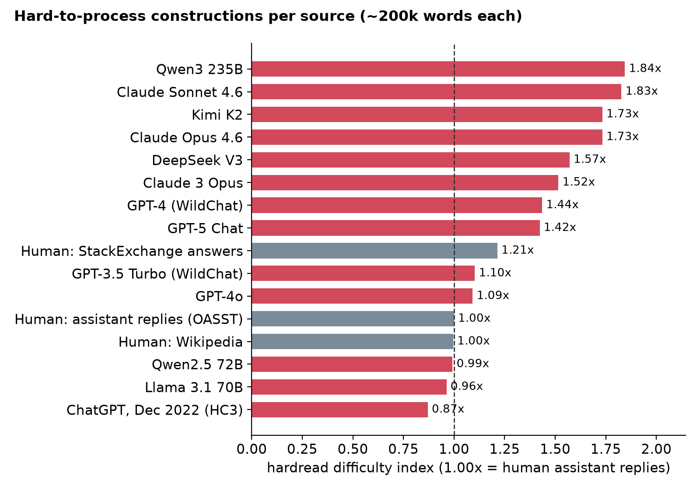

# Benchmark

Each source is about 200k-570k words of English text, scored with `hardread` 0.1.0 (`en_core_web_sm`) against the default `chat` baseline: human-written assistant replies from OpenAssistant. Cells are ratios to that baseline; 1.00x is human-like. The index is the mean of the first six columns, each capped at 5x.

| source | words | index | Inanimate subj. | Unattested pairs | Dep. length | Stacked nouns | ORC, no 'that' | Denominal | ORC with 'that' |
|---|---:|---:|---:|---:|---:|---:|---:|---:|---:|
| Qwen3 235B | 205,747 | **1.84x** | 3.04x | 2.68x | 1.04x | 1.27x | 0.63x | 2.41x | 0.25x |
| Claude Sonnet 4.6 | 218,063 | **1.83x** | 2.06x | 3.28x | 1.01x | 2.12x | 0.67x | 1.82x | 0.73x |
| Kimi K2 | 193,788 | **1.73x** | 3.24x | 2.29x | 1.10x | 1.17x | 0.76x | 1.83x | 0.44x |
| Claude Opus 4.6 | 188,813 | **1.73x** | 1.61x | 2.32x | 1.05x | 2.07x | 1.30x | 2.04x | 0.27x |
| DeepSeek V3 | 195,370 | **1.57x** | 1.72x | 2.65x | 1.04x | 1.36x | 0.48x | 2.18x | 0.16x |
| Claude 3 Opus | 245,335 | **1.52x** | 2.42x | 1.92x | 1.00x | 0.92x | 0.62x | 2.22x | 0.40x |
| GPT-4 (WildChat) | 231,854 | **1.44x** | 2.10x | 1.88x | 1.00x | 1.15x | 0.80x | 1.68x | 0.75x |
| Human: HC3 answers (ELI5, finance...) | 368,378 | **1.43x** | 2.48x | 1.30x | 1.04x | 0.73x | 1.56x | 1.44x | 1.31x |
| GPT-5 Chat | 212,098 | **1.42x** | 1.66x | 2.02x | 1.01x | 1.54x | 0.94x | 1.37x | 0.41x |
| Human: fiction (Gutenberg) | 205,414 | **1.42x** | 2.60x | 1.48x | 1.07x | 0.13x | 1.13x | 2.11x | 1.90x |
| Gemini 2.0 Flash (HC3 Qs) | 256,818 | **1.27x** | 2.75x | 1.09x | 1.01x | 0.65x | 1.30x | 0.80x | 1.42x |
| Human: StackExchange answers | 305,456 | **1.21x** | 1.60x | 1.39x | 1.05x | 0.57x | 1.22x | 1.47x | 1.56x |
| Claude essays (Ghostbuster) | 456,986 | **1.14x** | 1.43x | 1.91x | 0.98x | 1.09x | 0.40x | 1.03x | 0.79x |
| GPT-3.5 Turbo (WildChat) | 243,080 | **1.10x** | 1.30x | 1.37x | 1.01x | 0.83x | 0.80x | 1.31x | 0.71x |
| GPT-4o | 233,056 | **1.09x** | 0.90x | 1.60x | 1.01x | 0.98x | 1.01x | 1.05x | 0.28x |
| ChatGPT essays (Ghostbuster) | 571,009 | **1.01x** | 1.33x | 1.33x | 0.97x | 1.25x | 0.45x | 0.71x | 0.58x |
| Human: assistant replies (OASST) | 288,888 | **1.00x** | 1.00x | 1.00x | 1.00x | 1.00x | 1.00x | 1.00x | 1.00x |
| Human: essays | 97,686 | **1.00x** | 1.24x | 1.51x | 0.98x | 0.96x | 0.46x | 0.84x | 1.22x |
| Human: Wikipedia | 304,725 | **1.00x** | 0.77x | 2.00x | 1.01x | 0.94x | 0.28x | 0.98x | 0.75x |
| Qwen2.5 72B | 228,423 | **0.99x** | 1.09x | 1.09x | 0.96x | 1.47x | 0.42x | 0.91x | 0.36x |
| Llama 3.1 70B | 241,730 | **0.96x** | 1.00x | 1.19x | 0.99x | 1.06x | 0.70x | 0.83x | 0.56x |
| ChatGPT, Dec 2022 (HC3) | 254,102 | **0.87x** | 0.86x | 0.75x | 0.98x | 0.74x | 1.05x | 0.84x | 2.33x |

## What stands out

- Recent frontier chat models score 1.4x to 1.8x: Qwen3 235B 1.84x, Claude Sonnet 4.6 1.83x, Kimi K2 1.73x, Claude Opus 4.6 1.73x, DeepSeek V3 1.57x, GPT-5 Chat 1.42x.
- Older or smaller models sit near human: ChatGPT from Dec 2022 0.87x, Llama 3.1 70B 0.96x, Qwen2.5 72B 0.99x, GPT-3.5 Turbo 1.10x.
- Unattested word pairs (collocations absent from 10.6M words of human text) are the strongest signal: 1.9x to 3.3x for the frontier models.
- Outside the HC3 question set, every model uses object relatives *with* "that" at 0.16x to 0.75x the human rate. This matches the paper's finding that models skip optional words. The two HC3 sets (ChatGPT 2022, Gemini 2.0 Flash) are the exception.

## Caveats

- Prompts differ between sources. WildChat, LMSYS, Magpie and the distillation sets each have their own prompt mix, so some of the gap is topic, not style. Only two comparisons are prompt-matched: HC3 human vs ChatGPT (same questions) and the Ghostbuster essays (same prompts).
- HC3's human answers (Reddit ELI5, finance and medical forums) score 1.43x, and fiction scores 1.42x. Human genres vary a lot, so choose a baseline that matches your text (`-b qa`, `-b wiki`, `-b essay`, `-b fiction`).
- Model names come from the dataset cards and are not verified, especially for community distillation sets.
- These are heuristic detectors, not the paper's classifier. See [method.md](method.md).

## Sources

| source | Hugging Face dataset |
|---|---|
| Human: assistant replies (OASST) | `OpenAssistant oasst2 (held out)` |
| Human: StackExchange answers | `StackExchange (held out)` |
| Human: Wikipedia | `Wikipedia (held out)` |
| Human: essays | `Ghostbuster essays (held out)` |
| Human: fiction (Gutenberg) | `Gutenberg (held out)` |
| Human: HC3 answers (ELI5, finance...) | `Hello-SimpleAI/HC3` |
| ChatGPT, Dec 2022 (HC3) | `Hello-SimpleAI/HC3` |
| Gemini 2.0 Flash (HC3 Qs) | `SES-Lab-OTH/HC3-Gemini-Flash-Responses` |
| GPT-3.5 Turbo (WildChat) | `allenai/WildChat` |
| GPT-4 (WildChat) | `allenai/WildChat` |
| Claude 3 Opus | `nothingiisreal/Claude-3-Opus-Instruct-15K` |
| Claude Sonnet 4.6 | `TeichAI/Claude-Sonnet-4.6-Reasoning-1100x` |
| Claude Opus 4.6 | `TeichAI/Claude-Opus-4.6-Reasoning-887x` |
| GPT-5 Chat | `ytz20/LMSYS-Chat-GPT-5-Chat-Response` |
| GPT-4o | `HamsterTheRipper/gpt-4o-latest-distill-sft` |
| DeepSeek V3 | `nebius/DeepSeek-V3-Infinity-Instruct-0625` |
| Kimi K2 | `AQ-MedAI/Kimi-K2-Instruct-open-perfectblend-regenerate` |
| Qwen3 235B | `Jackrong/Qwen3-235B-A22B-Instruct-2507-Distilled-chat` |
| Llama 3.1 70B | `Magpie-Align/Magpie-Llama-3.1-Pro-300K-Filtered` |
| Qwen2.5 72B | `Magpie-Align/Magpie-Qwen2.5-Pro-300K-Filtered` |
| Claude essays (Ghostbuster) | `polsci/ghostbuster-essay-cleaned` |
| ChatGPT essays (Ghostbuster) | `polsci/ghostbuster-essay-cleaned` |

Reproduce: download the sets, convert them to JSONL with a `text` field, and run `python scripts/benchmark.py <files> --baseline chat --out docs/benchmark -j 8`.
